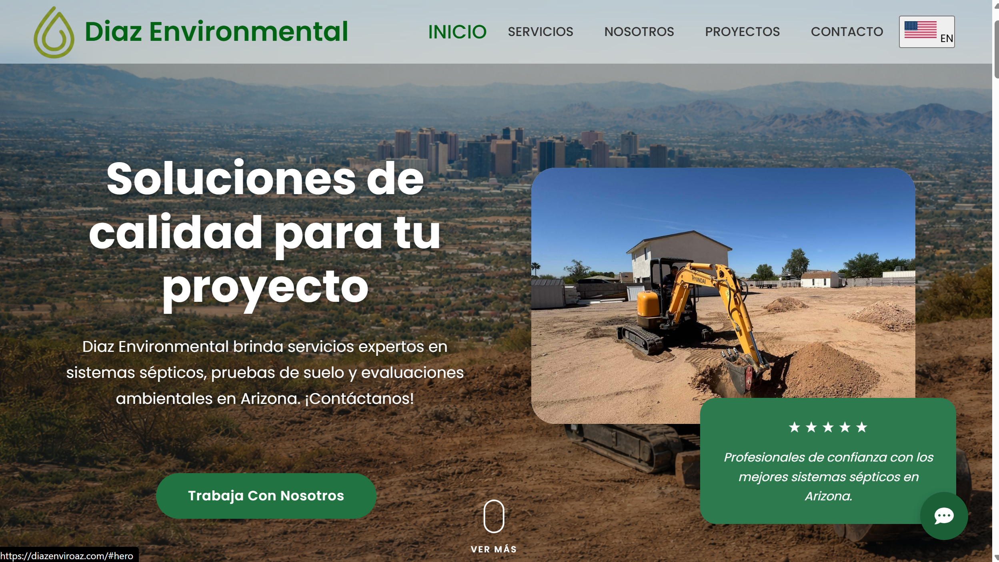

# Diaz Environmental — Sitio web

Sitio web corporativo de **Diaz Environmental LLC**, empresa de diseño de sistemas sépticos y pruebas de suelo en Arizona, Estados Unidos.

**Sitio en vivo:** [diazenviroaz.com](https://diazenviroaz.com)



## Sobre el proyecto

Proyecto desarrollado por encargo para un cliente real. El objetivo era tener presencia en línea, explicar los servicios de la empresa y facilitar que los clientes soliciten una inspección o cotización.

## Funcionalidades

- **Bilingüe (inglés / español)**, ya que la empresa atiende a clientes de habla inglesa e hispana.
- **Páginas por zona de servicio** (Tonopah, Laveen, Queen Creek, condados de Pinal, Yavapai y La Paz, entre otras) para mejorar el posicionamiento en buscadores locales.
- **Formulario de contacto** para captar clientes, con selección del tipo de servicio.
- **Sección de servicios y portafolio de proyectos** filtrable por categoría.
- Accesos rápidos de contacto: llamada, WhatsApp, correo y SMS.
- Página de preguntas frecuentes.
- Diseño adaptable a celular, tableta y escritorio.

## Tecnologías

- [Astro](https://astro.build)
- React
- TypeScript
- HTML y CSS

## Ejecutar en local

```bash
npm install
npm run dev
```

El sitio queda disponible en `http://localhost:4321`.

## Autor

**Ángel David Díaz Villanueva**
Desarrollador Web y Móvil
[GitHub](https://github.com/david220506h) · diazdavid2435@gmail.com
